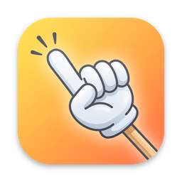
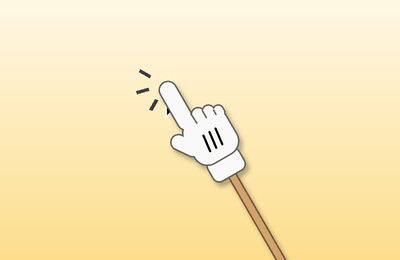

<a id="readme-top"></a>

<!-- PROJECT SHIELDS -->
[![Contributors][contributors-shield]][contributors-url]
[![Forks][forks-shield]][forks-url]
[![Stargazers][stars-shield]][stars-url]
[![Issues][issues-shield]][issues-url]
[![MIT License][license-shield]][license-url]
![macOS 12+][macos-shield]
![Swift][swift-shield]

<!-- PROJECT LOGO -->
<br />
<div align="center">
  <a href="https://github.com/noxhsxrk/finger-stick">
    
  </a>

  <h3 align="center">FingerStick</h3>

  <p align="center">
    Hold <kbd>Control</kbd> (or any modifier you pick). A pointing hand on a stick taps your screen. <em>Tok tok tok.</em>
    <br />
    <a href="#installation"><strong>Install it »</strong></a>
    <br />
    <br />
    <a href="#usage">See how it works</a>
    &middot;
    <a href="https://github.com/noxhsxrk/finger-stick/issues/new?labels=bug">Report Bug</a>
    &middot;
    <a href="https://github.com/noxhsxrk/finger-stick/issues/new?labels=enhancement">Request Feature</a>
  </p>
</div>

<!-- TABLE OF CONTENTS -->
<details>
  <summary>Table of Contents</summary>
  <ol>
    <li>
      <a href="#about-the-project">About The Project</a>
      <ul>
        <li><a href="#built-with">Built With</a></li>
      </ul>
    </li>
    <li>
      <a href="#getting-started">Getting Started</a>
      <ul>
        <li><a href="#prerequisites">Prerequisites</a></li>
        <li><a href="#installation">Installation</a></li>
      </ul>
    </li>
    <li><a href="#usage">Usage</a></li>
    <li><a href="#roadmap">Roadmap</a></li>
    <li><a href="#contributing">Contributing</a></li>
    <li><a href="#license">License</a></li>
    <li><a href="#contact">Contact</a></li>
    <li><a href="#acknowledgments">Acknowledgments</a></li>
  </ol>
</details>

<!-- ABOUT THE PROJECT -->
## About The Project

[![FingerStick banner: a pointing hand on a stick taps a laptop screen][product-screenshot]](https://github.com/noxhsxrk/finger-stick)

You know those videos where someone explains things by tapping the screen with a little hand-on-a-stick
pointer, *tok tok tok*, over and over? FingerStick puts that pointer on your Mac.

Hold <kbd>Control</kbd> (or Option, Command, Shift or Fn) and the stick appears with its fingertip right on your mouse cursor. It keeps
tapping, with a clacky sound on every hit, until you let go. Great for screen recordings, live demos,
teaching, and mildly annoying your coworkers on a screen share.

<p align="center">
  
  <br>
  <sub>One tap cycle, slowed down. The real thing taps 5 times a second.</sub>
</p>

* **No permissions.** No Accessibility or Input Monitoring prompts. It only reads which modifier keys are down.
* **Stays out of the way.** The overlay ignores clicks and never takes focus. It floats above full-screen apps, including games and video players that put their window above everything else, and is set to follow you across Spaces and displays.
* **Any sound.** Four synthesized taps (Clack, Knock, Tick, Bonk), every built-in macOS alert sound, or your own audio file.
* **Your key.** Trigger it with Control, Option, Command, Shift or Fn.
* **Tiny.** One Swift file, all art drawn in code, no dependencies. Lives in the menu bar as ☝️.

<p align="right">(<a href="#readme-top">back to top</a>)</p>

### Built With

* [![Swift][swift-badge]][swift-url]
* [![AppKit][appkit-badge]][appkit-url]

<p align="right">(<a href="#readme-top">back to top</a>)</p>

<!-- GETTING STARTED -->
## Getting Started

### Prerequisites

* macOS 12 Monterey or later (Apple Silicon or Intel)
* [Homebrew](https://brew.sh), for the one-line install
* To build from source: the Xcode Command Line Tools
  ```sh
  xcode-select --install
  ```

### Installation

**With Homebrew (recommended)**

```sh
brew tap noxhsxrk/nox
brew trust --cask noxhsxrk/nox/fingerstick   # Homebrew 7+ only loads third-party casks you trust
brew install --cask noxhsxrk/nox/fingerstick
open -a FingerStick
```

**From the release**

1. Download `FingerStick-<version>.zip` from the [latest release](https://github.com/noxhsxrk/finger-stick/releases/latest).
2. Unzip it and drag `FingerStick.app` to `/Applications`.
3. The app isn't notarized yet, so macOS may block the first launch. Choose **Open Anyway** in
   *System Settings → Privacy & Security*, or run:
   ```sh
   xattr -dr com.apple.quarantine /Applications/FingerStick.app
   ```
   Homebrew installs open straight away.

**From source**

```sh
git clone https://github.com/noxhsxrk/finger-stick.git
cd finger-stick
./build.sh --open
```

<p align="right">(<a href="#readme-top">back to top</a>)</p>

<!-- USAGE EXAMPLES -->
## Usage

| Do this | What happens |
|---|---|
| Hold the trigger key (<kbd>Control</kbd> by default) on its own | The stick appears at the cursor and taps until you let go |
| Move the mouse while holding | The stick follows the cursor |
| ☝️ → **Trigger Key** | Use Control, Option, Command, Shift or Fn instead |
| ☝️ → **Sound** | Pick a sound. It plays a preview and is remembered |
| ☝️ → **Sound** → **Choose Sound File…** | Use your own AIFF, WAV, MP3 or M4A. Short clips work best |
| ☝️ → **Launch at Login** | Start FingerStick when you log in (macOS 13+) |
| ☝️ → **Quit FingerStick** | Quit |

The trigger key has to be held on its own for 0.15 s before the stick shows, so a quick press or a fast
shortcut like <kbd>⌃</kbd><kbd>C</kbd> doesn't trigger it. If you hold it longer (say, for a <kbd>⌃</kbd>-click),
the stick shows up too. It never blocks the click.

If you pick **Fn**, macOS may also run its own Fn/🌐 action (emoji picker, input source) when you let go.
Set *System Settings → Keyboard → Press 🌐 key to* **Do Nothing** to stop that.

**Tweaking.** The constants at the top of [`main.swift`](main.swift) control the feel: `tapPeriod` (tap
speed), `liftDeg` (how far the stick swings), `holdDelay`, and the stick size. Rebuild with `./build.sh`.

**Checking a build.**

```sh
build/FingerStick.app/Contents/MacOS/FingerStick --selftest /tmp   # asserts sound + drawing, writes impact.png / lifted.png
build/FingerStick.app/Contents/MacOS/FingerStick --demo            # pretends the trigger is held for 2 s, counts taps
```

<p align="right">(<a href="#readme-top">back to top</a>)</p>

<!-- ROADMAP -->
## Roadmap

- [x] Pointing stick that follows the cursor while Control is held
- [x] Tap animation with a sound on every impact
- [x] Sound picker with synthesized and system sounds
- [x] Universal build and Homebrew cask
- [x] Choose the trigger key (Option, Command, Shift, Fn)
- [x] Use your own sound file
- [x] Launch at login toggle in the menu
- [ ] Notarized builds

See the [open issues](https://github.com/noxhsxrk/finger-stick/issues) for proposed features and known issues.

<p align="right">(<a href="#readme-top">back to top</a>)</p>

<!-- CONTRIBUTING -->
## Contributing

Contributions are welcome. If you have an idea that would make FingerStick better, fork the repo and
open a pull request, or open an issue with the tag "enhancement".

1. Fork the Project
2. Create your Feature Branch (`git checkout -b feature/AmazingFeature`)
3. Commit your Changes (`git commit -m 'Add some AmazingFeature'`)
4. Push to the Branch (`git push origin feature/AmazingFeature`)
5. Open a Pull Request

Please run `./build.sh` and the `--selftest` check before sending a PR.

<p align="right">(<a href="#readme-top">back to top</a>)</p>

<!-- LICENSE -->
## License

Distributed under the MIT License. See [`LICENSE`](LICENSE) for more information.

<p align="right">(<a href="#readme-top">back to top</a>)</p>

<!-- CONTACT -->
## Contact

noxhsxrk on GitHub: [@noxhsxrk](https://github.com/noxhsxrk)

Project Link: [https://github.com/noxhsxrk/finger-stick](https://github.com/noxhsxrk/finger-stick)

<p align="right">(<a href="#readme-top">back to top</a>)</p>

<!-- ACKNOWLEDGMENTS -->
## Acknowledgments

* Every teacher video that tapped the screen one too many times
* [Best-README-Template](https://github.com/othneildrew/Best-README-Template)
* [Shields.io](https://shields.io)
* App icon and banner art generated with Google Gemini

<p align="right">(<a href="#readme-top">back to top</a>)</p>

<!-- MARKDOWN LINKS & IMAGES -->
[contributors-shield]: https://img.shields.io/github/contributors/noxhsxrk/finger-stick.svg?style=for-the-badge
[contributors-url]: https://github.com/noxhsxrk/finger-stick/graphs/contributors
[forks-shield]: https://img.shields.io/github/forks/noxhsxrk/finger-stick.svg?style=for-the-badge
[forks-url]: https://github.com/noxhsxrk/finger-stick/network/members
[stars-shield]: https://img.shields.io/github/stars/noxhsxrk/finger-stick.svg?style=for-the-badge
[stars-url]: https://github.com/noxhsxrk/finger-stick/stargazers
[issues-shield]: https://img.shields.io/github/issues/noxhsxrk/finger-stick.svg?style=for-the-badge
[issues-url]: https://github.com/noxhsxrk/finger-stick/issues
[license-shield]: https://img.shields.io/github/license/noxhsxrk/finger-stick.svg?style=for-the-badge
[license-url]: https://github.com/noxhsxrk/finger-stick/blob/main/LICENSE
[macos-shield]: https://img.shields.io/badge/macOS-12%2B-1f2328?style=for-the-badge&logo=apple&logoColor=white
[swift-shield]: https://img.shields.io/badge/Swift-5-F05138?style=for-the-badge&logo=swift&logoColor=white
[product-screenshot]: docs/images/banner.jpg
[swift-badge]: https://img.shields.io/badge/Swift-F05138?style=for-the-badge&logo=swift&logoColor=white
[swift-url]: https://www.swift.org
[appkit-badge]: https://img.shields.io/badge/AppKit-000000?style=for-the-badge&logo=apple&logoColor=white
[appkit-url]: https://developer.apple.com/documentation/appkit
